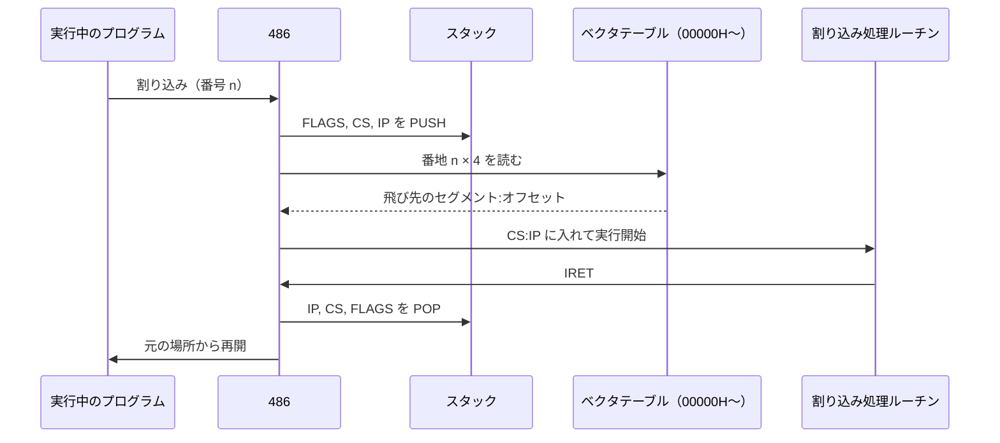
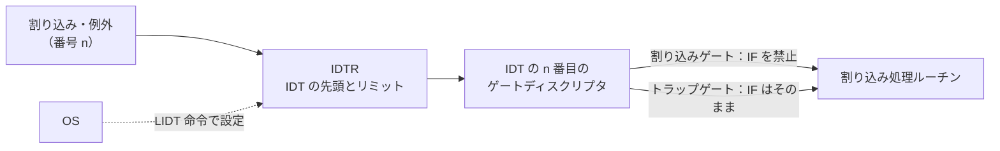
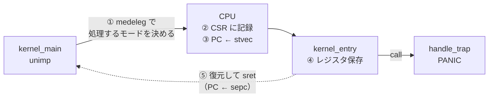

# 08 例外処理

教材：[例外処理 | OS in 1,000 Lines](https://operating-system-in-1000-lines.vercel.app/ja/08-exception)

## この章で答えたい問い

<!-- 例：不正な命令を実行したとき、CPU はどこへ飛び、何を保存し、カーネルはどうやって原因を知るのか -->

## 例外とは

『はじめて読む486』第7章（p.225〜232 まで読んだ時点）の整理。

### 割り込みの流れ（486 本 7.1）


1. 割り込みの発生：何かのきっかけ（割り込み要因）で、実行中のプログラムが中断される。
2. 処理ルーチンの呼び出し：割り込み要因の種類ごとに用意された処理ルーチンが選ばれる。
3. 処理ルーチンの実行：要因に応じた処理をする。
4. 終了：処理が終わったら、中断した場所に戻って元のプログラムを続ける。

RISC-V で読み替えると（推論、08章のコードで確かめる）：

| 486 本の段階 | 08章の RISC-V |
| --- | --- |
| ① 割り込み要因で中断 | `unimp` を実行して例外が起きる |
| ② ルーチンが選ばれる | CPU が `stvec` の番地（`kernel_entry`）へ飛ぶ。種類ごとの振り分けは `handle_trap` が `scause` を見てソフトウェアで行う |
| ③ 処理する | `handle_trap` |
| ④ 元に戻る | `kernel_entry` の最後の `sret`。08章では `handle_trap` が `PANIC` するので戻らない |

### 割り込みの種類（486 本 表7-1）

割り込みは、きっかけの出どころで大きく2つに分かれる。

| 種類 | | きっかけ |
| --- | --- | --- |
| ハードウェア割り込み | | CPU の外の周辺機器からの信号 |
| 例外割り込み | トラップ | `INT` 命令などを実行したとき（ソフトウェア割り込み） |
| | フォールト | 保護機能や MMU のチェックに引っかかったとき |
| | アボート | 処理を続けられないエラーが起きたとき |

08章で扱うのは、例外割り込みのほう（命令を実行した結果として起きるもの）。

### トラップ・フォールト・アボートの違い（486 本 7.3、p.233〜237）

3種類の違いは「例外のあと、どこから実行を続けるか」で整理できる。

| 種類 | きっかけ | 例外のあと |
| --- | --- | --- |
| トラップ | `INT` 命令を実行したとき（必ず起きる） | 処理ルーチンが終わったら、元のプログラムに戻って続ける |
| フォールト | 命令を実行しようとしたとき、例外の状態が見つかった（起きるかどうかは状況しだい） | 保護に関するもの（セグメントの範囲外など）は、多くの場合そのプログラムを強制終了する。メモリ管理に関するものは、メモリを配置し直してから、例外を起こした命令をもう一度実行する |
| アボート | フォールトの処理を始めようとして、またフォールトが起きたときなど | 原因を突き止めにくく、元に戻るのは困難なので強制終了 |

- 「元の処理を続けるのが困難」なのはアボート。フォールトは、種類によって「戻れない」と「やり直せる」に分かれる。
- MS-DOS では、アプリケーションが OS や BIOS を呼ぶのにトラップ（`INT 21H` など）を使っていた。推論：RISC-V の `ecall` が同じ役割で、05 章ではカーネルが OpenSBI を呼ぶのに使った。

割り込み番号の決まり（p.236〜237）：

- 4 種類（ハードウェア割り込み、トラップ、フォールト、アボート）で共通の番号 `00H`〜`FFH` を使う。
- フォールトとアボートの番号は固定で、変えられない（例：アボートのダブルフォールトは `08H`）。
- `20H` より小さい番号はインテルの予約。ハードウェア割り込みとトラップには `20H` 以上を使う。

RISC-V とつなげる観点（推論、08章で確かめる）：

- 08章で使う `unimp`（不正な命令）は、486 で言えばフォールトに近い。
- そのとき `sepc` が「例外を起こした命令そのもの」を指すのか、「次の命令」を指すのかで、やり直せる作りかどうかが分かる。`llvm-addr2line` で `sepc` をソースの行に戻して確かめる。

### 飛び先の決め方（486 本 7.4、p.238〜242）

#### リアルモード：割り込みベクタテーブル

- 割り込み処理ルーチンの番地を、割り込み番号の順に並べた表。
- 置き場所は物理アドレス `00000H` からの 1024 バイトに固定されている（4 バイト × 256 個）。
- 割り込みが起きると、486 は FLAGS、CS、IP をこの順にスタックへ積み、`番号 × 4` の番地から飛び先（セグメントとオフセット）を読んで CS と IP に入れる。
- 処理ルーチンの最後の `IRET` で、IP、CS、FLAGS をスタックから戻し、元のプログラムを続ける。



#### プロテクトモード：割り込みディスクリプタテーブル（IDT）

- 番地を直接並べる代わりに、ゲートディスクリプタを並べた表を使う。並び順が割り込み番号に対応する（例：`0DH` のフォールトなら `0DH` 番目のゲート）。
- ゲートは3種類。
  - 割り込みゲート：処理ルーチンに入るとき、割り込み許可フラグを禁止にする。ハードウェア割り込みでは、処理が終わるまで次の割り込みを受け付けたくないので、ふつうこちらを使う。
  - トラップゲート：割り込み許可フラグを、割り込み前の状態のまま入る。それ以外は割り込みゲートと同じ。
  - タスクゲート：8章で扱う。
- IDT の置き場所は固定ではない。OS が `IDTR` レジスタに表の先頭アドレスとリミット値を設定する。設定には `LIDT` 命令を使い、C では書けないのでアセンブリで書く。
- ハードウェア割り込み、トラップ、フォールトのどれでも、この仕組みは同じ。



#### RISC-V との対応（一般知識・推論、08章のコードで確かめる）

| 486 | RISC-V（08章） |
| --- | --- |
| ベクタテーブル / IDT（番号ごとに飛び先を並べた表） | 表はない。`stvec` に入れた1つの番地（`kernel_entry`）へ飛ぶ |
| `IDTR` と `LIDT` 命令（アセンブリでしか書けない） | `stvec` と `csrw` 命令。C から使うため `WRITE_CSR` マクロで包む |
| 番号で表を引いて振り分ける（ハードウェアが行う） | `scause` を見て `handle_trap` が振り分ける（ソフトウェアが行う） |
| FLAGS、CS、IP をスタックへ積む | スタックには何も積まない。戻り先は `sepc`、原因は `scause`、元のモードと割り込み許可は `sstatus` の SPP / SPIE（CSR に入る） |
| 汎用レジスタ | どちらも OS が自分で保存する（08章の `kernel_entry` と `trap_frame`） |
| 割り込みゲートで IF を禁止 | 例外に入ると `sstatus` の SIE が 0 になる（元の値は SPIE に残る） |
| `IRET` | `sret` |

推論：RISC-V は、ハードウェアがやることを「飛ぶ」と「いくつかの CSR に記録する」だけに絞り、表を引く処理やスタックへの保存をソフトウェアに任せている。

### ハードウェア割り込み（486 本 7.2）

- 割り込みコントローラが、たくさんの機器からの要求のうち優先度の高いものを1つ選び、CPU にその機器の「割り込み番号」を伝える。
- 割り込み番号は 1 バイト（`00H`〜`FFH` の 256 種類）。番号ごとに割り込み処理ルーチンを用意しておく。どの機器に何番を割り当てるかは、起動時に BIOS やデバイスドライバが設定する。
- ハードウェア割り込みがないと、プログラムが時々機器の状態を見に行くしかない（ポーリング）。見に行く間隔が空くと、入力を取りこぼすことがある。
- EFLAGS の第9ビット（割り込み許可フラグ、IF）が 0 の間は、ハードウェア割り込みを受け付けない。`CLI` で 0、`STI` で 1 にする。禁止中に来た信号は、許可したとたんに割り込みとして発生する。
- 486 本の例題では、プロテクトモードへ切り替える途中など、割り込みが来ると困る区間を `CLI` で守っていた。

RISC-V との対応（一般知識、未確認）：

| 486 | RISC-V（QEMU virt） |
| --- | --- |
| 割り込みコントローラ | PLIC（`riscv-intro.md` の `info mtree` で見えた `0x0c00_0000`） |
| 割り込み番号 | `scause` の最上位ビットが 1 なら割り込み、残りのビットが原因の番号。外部機器のどれかは PLIC に問い合わせる |
| IF フラグ、`CLI` / `STI` | `sstatus` の SIE ビット（S-mode 全体の許可）と `sie`（種類ごとの許可）。`csrc` / `csrs` 命令で操作する |

この OS は、ハードウェア割り込みを使わず、ポーリングで代用する（`overview.md` の「実装しない機能」）。486 本の言う取りこぼしの問題は、この OS では起こりうることになる（推論）。

## どこから入り、どこへ戻るか



| 段階 | 誰がやるか | 中身 |
| --- | --- | --- |
| ① どのモードで処理するか決める | CPU | `medeleg` を見る（「medeleg：例外はどのモードに届くか」） |
| ② 状態を記録する | CPU | `scause`、`stval`、`sepc`、`sstatus` に書き込む |
| ③ 例外ハンドラへ飛ぶ | CPU | `stvec` の値を PC に入れる |
| ④ 汎用レジスタを保存し、原因に応じて処理する | OS | `kernel_entry` が `sp` を `sscratch` に退避し、31 個のレジスタをスタックに積んで `handle_trap` を呼ぶ |
| ⑤ 復元して戻る | 復元は OS、戻るのは CPU | `kernel_entry` がレジスタを戻して `sret`。CPU が `sepc` の番地へ戻る |

- CPU が自動でやるのは ①〜③ と ⑤ の `sret` だけ。スタックには触らない。
- 08章では `handle_trap` が `PANIC` するので、⑤（点線）は実際には通らない。
- 486 では、CPU が FLAGS、CS、IP をスタックに積む（「飛び先の決め方」）。RISC-V では、その代わりに CSR に記録する。

## 使う CSR

| CSR | 中身 | 誰が書くか | 誰が読むか |
| --- | --- | --- | --- |
| `stvec` | 例外ハンドラの番地（下位 2 ビットはモード） | OS（`kernel_main` で `kernel_entry` を設定） | CPU（例外のとき PC に入れる） |
| `scause` | 例外の種類（`2` = 不正な命令） | CPU | OS（`handle_trap`） |
| `stval` | 例外の付加情報。中身は種類による（メモリ関係なら原因の番地など） | CPU | OS（`handle_trap`） |
| `sepc` | 例外が起きた命令の番地 | CPU | OS（`handle_trap`）、CPU（`sret` で戻る先） |
| `sstatus` | 例外の前のモード（SPP ビット）など | CPU | CPU（`sret`）、OS |
| `sscratch` | OS が自由に使ってよい置き場所 | OS（`kernel_entry` が `sp` を退避） | OS（`kernel_entry`） |

## READ_CSR / WRITE_CSR

`kernel.h` に書いた。

- CSR は `csrr`（読む）と `csrw`（書く）という専用の命令でしか触れない。C には CSR を表す書き方がないので、インラインアセンブリで包む。
- `#reg` は、マクロの引数を文字列にするプリプロセッサの機能。`READ_CSR(scause)` は `"csrr %0, " "scause"` となり、文字列がつながって `csrr %0, scause` という命令になる。
- CSR の名前は命令に直接埋め込む必要がある（変数で渡せない）ので、関数ではなくマクロにしている（推論）。
- `READ_CSR` は `({ ... })` という書き方（GCC の拡張の文式）で、最後の `__tmp` がマクロ全体の値になる。
- 486 本の `LIDT` も C で書けずアセンブリで書いていた。CPU の特別なレジスタを触るときは、どちらもアセンブリが要る。

## trap_frame と kernel_entry

`kernel_entry`（`kernel.c`）は、例外のとき CPU が最初に飛んでくる関数。

1. `csrw sscratch, sp`：例外が起きたときの `sp` を `sscratch` に退避する。
2. `addi sp, sp, -4 * 31`：スタックに 31 個分（124 バイト）の場所を取る。
3. `ra`、`gp`、`tp`、`t0`〜`t6`、`a0`〜`a7`、`s0`〜`s11` を順に保存する。
4. `csrr a0, sscratch` で元の `sp` を取り出し、最後の場所に保存する。
5. `mv a0, sp` で、保存した場所の先頭を引数にして `handle_trap` を呼ぶ。
6. 戻ってきたら、同じ場所から全部のレジスタを戻し（最後に `sp`）、`sret` する。

スタック上の並び（番地の大きい方が上）：

```
元の sp       → ┌──────────┐
                │ sp（元）  │ +120  ← sscratch から
                │ s11       │ +116
                │ ...       │
                │ a0        │ +40
                │ ...       │
                │ gp        │ +4
新しい sp = a0 → │ ra        │ +0
                └──────────┘
```

`struct trap_frame`（`kernel.h`）は、この並びと同じ順にメンバを並べた構造体。`handle_trap` は、引数のポインタを通して、例外のときのレジスタの値を読み書きできる。

- `__attribute__((packed))`：メンバの間に隙間を入れないようにする。全部 `uint32_t` なので、なくても同じ並びになるはず（推論）。
- `__attribute__((naked))`：関数の前後にコンパイラが命令を足さないようにする。`kernel_entry` に入った瞬間のレジスタは「例外の前のプログラム」の値なので、コンパイラにスタックやレジスタを勝手に触らせない（04 章の `boot` と同じ理由）。
- `__attribute__((aligned(4)))`：関数の先頭を 4 バイト境界にそろえる。`stvec` の下位 2 ビットはモードを表すので、番地の下位 2 ビットが 0 でないと正しく設定できない。
- 浮動小数点レジスタは、カーネルで使わないので保存しない。
- `zero` レジスタ（`x0`）は常に 0 なので保存しない。`ra` から `sp` までの 31 個になる。

### sscratch を使う理由

レジスタを保存するには、どこかのレジスタを使って番地を作る必要がある。しかし、`kernel_entry` に入った時点では、どのレジスタにも例外の前のプログラムの値が入っていて、勝手に壊せない。そこで、汎用レジスタではない `sscratch` に `sp` を一時的に逃がしている。

推論：今は S-mode の中で例外が起きるので、そのままのスタックを使っている。U-mode のアプリで例外が起きたときは、アプリのスタックを信用できないので、`sscratch` の使い方が変わるはず（アプリの章で確かめる）。

## handle_trap

```c
void handle_trap(struct trap_frame *f) {
    uint32_t scause = READ_CSR(scause);
    uint32_t stval = READ_CSR(stval);
    uint32_t user_pc = READ_CSR(sepc);

    PANIC("unexpected trap scause=%x, stval=%x, sepc=%x\n", scause, stval, user_pc);
}
```

- `scause`、`stval`、`sepc` を読んで、そのまま `PANIC` する。今はどんな例外も「想定外」として止まる。
- 引数の `f`（保存したレジスタ）はまだ使っていない。
- `kernel_main` では、`WRITE_CSR(stvec, (uint32_t) kernel_entry)` で例外ハンドラの番地を CPU に教えてから、`unimp` でわざと例外を起こしている。

## medeleg：例外はどのモードに届くか

2026-11-22、14 章（システムコール）のときに解いた。`medeleg` の値の読み方と `ecall` の話は `system-call.md` の「medeleg：ecall はどのモードに届くか」。ここでは、不正な命令（`scause=2`）について書く。

### medeleg のビット 2

```
MEDELEG = 0x00f4b509
0x509 = 0101 0000 1001
                    ^
                  bit 2 = 0
```

ビット 2（不正な命令）は 0 で、委譲されていない。不正な命令は、まず M-mode の OpenSBI に届く。それなのに、08 章の `unimp` はカーネルの `handle_trap`（S-mode）が受け取った。

### 不正な命令は OpenSBI を経由していた（OpenSBI v1.8.1 のソース）

1. [`lib/sbi/sbi_trap.c` L328-L329](https://github.com/riscv-software-src/opensbi/v1.8.1/lib/sbi/sbi_trap.c#L328-L329)：`CAUSE_ILLEGAL_INSTRUCTION` -> `sbi_illegal_insn_handler`。
2. [`lib/sbi/sbi_illegal_insn.c`](https://github.com/riscv-software-src/opensbi/v1.8.1/lib/sbi/sbi_illegal_insn.c)：エミュレートできる命令（一部の CSR の読み出しなど）でなければ、`truly_illegal_insn` を呼ぶ。

```c
int truly_illegal_insn(ulong insn, struct sbi_trap_regs *regs)
{
    ...
    trap.cause = CAUSE_ILLEGAL_INSTRUCTION;
    trap.tval = insn;
    ...
    return sbi_trap_redirect(regs, &trap);
}
```

3. [`lib/sbi/sbi_trap.c` L103〜](https://github.com/riscv-software-src/opensbi/v1.8.1/lib/sbi/sbi_trap.c#L103) の `sbi_trap_redirect`：S-mode に例外が起きたように見せかける。`stval` <- 命令の中身、`sepc` <- 例外を起こした番地、`scause` <- 2、戻り先（`mepc`）<- `stvec`（カーネルの `kernel_entry`）、`SPP` <- 例外前のモード。そのあと `mret` で S-mode の `kernel_entry` に入る。

```
unimp (S-mode)
  -> medeleg bit 2 = 0 -> OpenSBI (M-mode)
       sbi_illegal_insn_handler: cannot emulate
       truly_illegal_insn -> sbi_trap_redirect
         scause = 2, stval = instruction, sepc = address of unimp
         mret to stvec (kernel_entry)
  -> kernel: handle_trap receives it in the same form as a delegated trap
```

- カーネルから見ると、委譲されたときとまったく同じ形で届く。08 章では、M-mode を経由したことに気づけなかった。
- `stval` に書いたのは OpenSBI（`trap.tval = insn`）。QEMU は M-mode の `mtval` に命令の中身を入れ（`cpu_helper.c` の L2364 の側）、OpenSBI がそれを使う。
- 16 ビット版の `unimp`（`0000`）では、`sbi_illegal_insn_handler` が `(insn & 3) != 3` を見て、`mepc` の番地から命令を読み直す。それでも `0000` なので、`truly_illegal_insn(0)` となり `stval = 0`。観察した値と合う。
- 32 ビット版の `unimp`（`c0001073`）は SYSTEM 命令の形なので、`system_opcode_insn` が CSR 命令としてエミュレートを試みる。推論：書き込めない CSR（`cycle`）への書き込みなので、エミュレートできずに `truly_illegal_insn` に回り、`stval = c0001073`。

## x86 との比較

<!-- 『はじめて読む486』第7章（p.225〜260）。共通する考え方 / 機種固有の仕組み。飛び先の決め方（IDT と stvec）、CPU が自動で保存する範囲、例外の種類と番号 -->

## 観察結果

2026-11-22、ホストの Arch で観察。

### 実行（./run.sh）

```
PANIC: kernel.c:35: unexpected trap scause=00000002, stval=00000000, sepc=8020010a
```

教材の出力例は `scause=00000002, stval=ffffff84, sepc=8020015e`。

| | 教材 | 自分の環境 |
| --- | --- | --- |
| `scause` | `2` | `2`（不正な命令）。一致 |
| `stval` | `ffffff84` | `00000000`。違う |
| `sepc` | `8020015e` | `8020010a`（番地は自分のコードで変わる） |

- `kernel.c:35` は `handle_trap` の中の `PANIC` の行。
- `stvec` に入れた `kernel_entry` へ飛び、`handle_trap` まで届いた。

### sepc の確認（llvm-objdump、llvm-addr2line）

```
$ llvm-objdump -d kernel.elf
80200106: 10551073   csrw stvec, a0
8020010a: 0000       unimp
8020010c: 10500073   wfi

$ llvm-addr2line -e kernel.elf 8020010a
/home/kawashima/work/private/my-os/kernel.c:121
```

読み取り：

- `kernel.c` の121行目は `__asm__ __volatile__("unimp");`。
- `sepc` は、例外を起こした `unimp` そのものを指していて、次の命令（`wfi`）ではない。486 で言うフォールトと同じで、原因を取り除けば同じ命令からやり直せる形。
- `unimp` は 2 バイトの命令で、中身は `0000`（圧縮命令）。
- `0x8020_0106` の `csrw stvec, a0` が `WRITE_CSR(stvec, ...)` の正体。

### stval=00000000 の出どころ（QEMU v11.1.3 のソース）

訂正（2026-11-22、14 章で OpenSBI のソースを読んで分かった）：この節では「S-mode で処理するなら `env->stval = tval`」の道筋をたどったが、実際には `medeleg` のビット 2 が 0 なので、不正な命令は M-mode の OpenSBI に届いていた。QEMU が入れたのは `mtval` で、`stval` に書いたのは OpenSBI。正しい流れは「medeleg：例外はどのモードに届くか」の「不正な命令は OpenSBI を経由していた」。以下は、最初に読んだときの記録として残す。

2026-11-22、QEMU v11.1.3 の `target/riscv/tcg/` を読んで、不正な命令の例外で `stval` に何が入るかをたどった（ソースを読んだだけで、実験では未確認）。

1. 命令を読むとき、長さを見分ける。16 ビット命令なら下位 16 ビットだけを `ctx->opcode` に入れる（[`translate.c` L1275-L1278](https://github.com/qemu/qemu/blob/v11.1.3/target/riscv/tcg/translate.c#L1275-L1278)）。`unimp` なら `0x0000`。
2. どの命令とも一致しなければ、`gen_exception_illegal` を呼ぶ（[`translate.c` L1305](https://github.com/qemu/qemu/blob/v11.1.3/target/riscv/tcg/translate.c#L1305)）。
3. `gen_exception_illegal` は、命令の中身 `ctx->opcode` を `bins` に保存してから、不正な命令の例外を起こす（[`translate.c` L264-L273](https://github.com/qemu/qemu/blob/v11.1.3/target/riscv/tcg/translate.c#L264-L273)）。
4. 例外の処理で、不正な命令なら `tval = env->bins` とする（[`cpu_helper.c` L2167-L2170](https://github.com/qemu/qemu/blob/v11.1.3/target/riscv/tcg/cpu_helper.c#L2167-L2170)）。
5. S-mode で処理するなら `env->stval = tval`（[`cpu_helper.c` L2284-L2286](https://github.com/qemu/qemu/blob/v11.1.3/target/riscv/tcg/cpu_helper.c#L2284-L2286)）。M-mode で処理するなら同じ値が `mtval` に入る（[L2364](https://github.com/qemu/qemu/blob/v11.1.3/target/riscv/tcg/cpu_helper.c#L2364)）。

```
unimp（中身 0x0000）
  → 16ビット命令として ctx->opcode = 0x0000
  → どの命令とも一致しない → gen_exception_illegal
  → bins = 0x0000
  → tval = bins → stval = 0x00000000
```

読み取り：

- QEMU 11.1.3 は、不正な命令の例外で、`stval` にその命令の中身を入れる。今回は `unimp` の中身がたまたま全部 0 だったので、`stval` も 0 になったと考えられる。
- ただし、この観察だけでは「何も入れなかったので 0」という可能性と区別できていない。中身が 0 でない不正な命令で確かめる（次の「32 ビット版の unimp で確かめる」）。
- 教材の `stval=ffffff84` の理由は、このソースからは分からない（教材は QEMU 8.0.2。`unimp` が何に変換されていたかも不明）。

### 32 ビット版の unimp で確かめる

2026-11-22、ホストの Arch で観察。`kernel.c` の `unimp` を、圧縮命令を使わない書き方に置き換えた。

```c
__asm__ __volatile__(".option push\n.option norvc\nunimp\n.option pop");
```

`.option norvc` の間は圧縮命令を使わないので、32 ビット版の `unimp` になる。

逆アセンブル（`llvm-objdump -d kernel.elf`）：

```
80200106: 10551073   csrw stvec, a0
8020010a: c0001073   unimp          ← 4 バイトになった
8020010e: 10500073   wfi            ← 0x8020010c から 0x8020010e にずれた
```

実行（`./run.sh`）：

```
PANIC: kernel.c:35: unexpected trap scause=00000002, stval=c0001073, sepc=8020010a
```

| `unimp` | 命令の中身 | `stval` |
| --- | --- | --- |
| 16 ビット版 | `0000` | `00000000` |
| 32 ビット版 | `c0001073` | `c0001073` |

読み取り：

- `stval` に、命令の中身 `c0001073` がそのまま入った。「`stval` には命令の中身が入る」ことが、実験でも確かめられた。ただし、入れたのは QEMU ではなく OpenSBI だった（訂正。「medeleg：例外はどのモードに届くか」）。
- 16 ビット版の `stval=00000000` は「何も入れなかったので 0」ではなく、「命令の中身が 0 だったので 0」だった。
- `scause=2`（不正な命令）は同じ。`sepc=8020010a` は 32 ビット版 `unimp` の番地で、今回も例外を起こした命令そのものを指している。
- llvm-objdump は `c0001073` も `unimp` と表示する。

逆アセンブルで気づいたこと：`grep unimp` には、`boot` の後ろの `8020000e: 0000 unimp` も引っかかった。これは自分で書いた `unimp` ではない。推論：次の関数（`kernel_main`）の先頭を 4 バイト境界にそろえるための 0 埋めを、逆アセンブラが `unimp` として表示している。`boot` は `j kernel_main` で終わるので、ここが実行されることはない。

## 次に試すこと

- [x] 中身が 0 でない不正な命令で例外を起こし、`stval` にその中身が入るか確かめる → 32 ビット版 `unimp`（`c0001073`）で `stval=c0001073`（「32 ビット版の unimp で確かめる」）
- [ ] `c0001073` を `csrrw` 命令として読み解き、どの CSR に書こうとしているのか、なぜ不正な命令になるのかを確かめる（`0xc00` が CSR の番号）
- [x] `kernel.c` の `unimp` を 16 ビット版に戻すか、32 ビット版のままにするか決める → 16 ビット版に戻した（32 ビット版はコメントで残す）
- [ ] 特権仕様の `stval`（と `mtval`）の節で、不正な命令のときに何を入れることになっているか（必ず入れるのか、実装しだいなのか）を確かめる
- [ ] 教材の `stval=ffffff84` の理由を、QEMU 8.0.2 のソースで調べる
- [ ] QEMU モニターの `info registers` で、例外のあとの `stvec`、`sepc`、`scause`、`stval` を見る
- [x] `medeleg 0x00f4b509` のビット2（`scause=2`）を確かめ、`unimp` の例外が最初にどのモードに届くか予想する。そのうえで、M-mode を経由したかどうかを確かめる方法を考える → ビット 2 は 0。M-mode の OpenSBI に届き、OpenSBI が S-mode に転送していた（OpenSBI のソースで確認。「medeleg：例外はどのモードに届くか」）
- [ ] QEMU のログ（`-d int`）で、`unimp` のときに M-mode の例外が起きていることを実際に見る

## 読んだ範囲・動かした範囲・疑問

- 読んだ範囲：『はじめて読む486』第7章 p.225〜242（7.1 割り込みとは、7.2 ハードウェア割り込み、7.3 例外割り込み、7.4 割り込み処理）。7.5 は 08 章のコードを書いたあとに読む。教材の 08 章は全部
- 動かした範囲：`kernel_entry`、`handle_trap`、`trap_frame`、`READ_CSR` / `WRITE_CSR` を書き、`unimp` で例外を起こして `PANIC` まで確認
- 疑問：
  - [x] トラップ、フォールト、アボートで、例外のあとどの命令から実行を続けるのか → 「トラップ・フォールト・アボートの違い」に記録
  - [x] `unimp` の例外で、`sepc` は例外を起こした命令とその次の命令のどちらを指すか → 例外を起こした命令そのもの（「観察結果」）
  - [ ] RISC-V にダブルフォールト（例外の処理中の例外）に当たるものはあるか。`kernel_entry` の中で例外が起きたらどうなるか
  - [ ] 486 の「割り込み番号ごとに処理ルーチンを選ぶ」仕組みと、RISC-V の「`stvec` の1か所に飛んでから `scause` で振り分ける」仕組みは、なぜ違うのか（材料は「飛び先の決め方」に記録。推論のみで、設計上の理由は未確認）
  - [ ] プロテクトモードで割り込みが起きたとき、486 はスタックに何を積むのか（p.242 の図は読み取れていない。特権レベルが変わるときにスタックも切り替わるか）。RISC-V の `sscratch` と比べる
